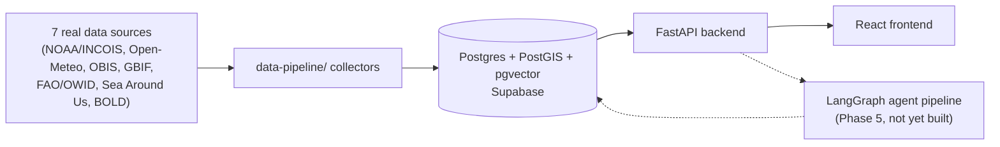

# OASIS

**AI-driven unified data platform for oceanographic, fisheries & molecular biodiversity insights.**

OASIS unifies six fragmented Indian marine data domains — oceanographic,
satellite-derived ocean products, weather, fisheries, biodiversity/species
occurrence, and molecular/eDNA — into one Postgres+PostGIS schema, then
layers a tool-constrained agentic pipeline (data cleaning → feature
engineering → prediction/forecasting → anomaly detection → explainable
recommendation) on top, surfaced through a GIS dashboard and an NL chatbot.

The full product/architecture/sprint plan lives in [`flow.md`](flow.md); the
phase-by-phase build plan actually followed is
[`OASIS_CLAUDE_CODE_BUILD_PROMPT.md`](OASIS_CLAUDE_CODE_BUILD_PROMPT.md).
This README tracks what's actually built.

## Architecture



See [`docs/architecture.md`](docs/architecture.md) for the full agent
workflow diagram and [`docs/database-schema.md`](docs/database-schema.md)
for the schema.

## Build status

| Phase | What | Status |
|---|---|---|
| 0 | Data pipeline: 8 real-data collectors, ~129K seed records | Done — schema applied and data loaded into a live Supabase project; row counts verified |
| 1 | FastAPI backend core: SQLAlchemy models, read API (6 domains), Alembic baseline | Done |
| 2 | Auth: Supabase Auth proxy + JWT verification | Done |
| 3 | React frontend: layout, auth, 6 domain explorer pages | Done |
| 4 | Feature engineering, prediction/forecasting models, anomaly detection | Not started — needs a populated DB to train/evaluate against |
| 5 | LangGraph agent pipeline, NL chatbot, pgvector RAG | Not started — needs `ANTHROPIC_API_KEY` + populated DB |
| 6 | Correlation Studio, eDNA similarity search, SHAP viz, session export | Not started (Should-Have, depends on 4/5) |
| 7 | Deployment/CI | `docker-compose.yml` + `backend-ci.yml`/`frontend-ci.yml` in place; not yet deployed to Render/Vercel/Supabase |
| 8 | Testing hardening | Backend: DB/Supabase-gated pytest suite (skips without credentials, doesn't fake). Frontend: manual Playwright smoke-check only, no component test suite yet |
| 9 | Documentation | This file + `docs/architecture.md`, `docs/api-reference.md`, `docs/database-schema.md`, `docs/demo-script.md` |

**Why Phases 4–6 are unstarted:** they require a live, seeded Postgres
database (Phase 4/5) and an Anthropic API key (Phase 5) to produce anything
that's actually verified rather than plausible-looking and untested — see
"No synthetic data" below. Provision Supabase (below) and set
`ANTHROPIC_API_KEY` to unblock them.

## Setup

### 1. Data pipeline + database

```bash
pip install -r data-pipeline/requirements.txt
cp .env.example .env   # fill in DATABASE_URL, SUPABASE_* — see docs/supabase-setup.md
python backend/db/apply_schema.py --check   # verify connection + extensions
python backend/db/apply_schema.py           # create schema
python data-pipeline/cleaning/load_seeds.py # load the committed ~129K real records
```

Full walkthrough: [`docs/supabase-setup.md`](docs/supabase-setup.md).

### 2. Backend

```bash
cd backend
pip install -r requirements.txt
uvicorn app.main:app --reload   # http://localhost:8000/docs
pytest                          # DB/Supabase-gated tests skip without credentials
```

### 3. Frontend

```bash
cd frontend
cp .env.example .env   # VITE_API_BASE_URL, optionally VITE_SUPABASE_*
npm install
npm run dev             # http://localhost:5173
```

### 4. Everything at once (local Postgres instead of Supabase)

```bash
cp .env.example .env   # SUPABASE_* still needed for auth — see docker-compose.yml's header comment
docker compose up --build
```

## Tech stack

Python/FastAPI/SQLAlchemy/Alembic backend, React/TypeScript/Vite/Tailwind
frontend, Postgres+PostGIS+pgvector on Supabase, scikit-learn/XGBoost/SHAP
for ML, LangGraph + Claude API for the agent pipeline. Full rationale in
[`flow.md` §2](flow.md#2-recommended-tech-stack).

## No synthetic data

Every number in this app traces to a real ingested record from a cited
public source (NOAA, OBIS, GBIF, FAO/OWID, Sea Around Us, BOLD, Open-Meteo) or a model
trained on one — see `data-pipeline/collectors/*.py` docstrings for each
source's API and
[`docs/developer-c-week1-flow.md`](docs/developer-c-week1-flow.md) for how
each was verified live. Tests follow the same rule: endpoint tests that
need real seeded data are DB-gated (`tests/conftest.py`) and skip — rather
than mock — when no database is configured.

## Docs

- [`docs/architecture.md`](docs/architecture.md) — agent workflow, built vs. planned
- [`docs/api-reference.md`](docs/api-reference.md) — every live endpoint
- [`docs/database-schema.md`](docs/database-schema.md) — human-readable schema + reconciliation notes
- [`docs/demo-script.md`](docs/demo-script.md) — walkthrough for a live evaluation
- [`docs/supabase-setup.md`](docs/supabase-setup.md) — provisioning Supabase
- [`docs/developer-c-week1-flow.md`](docs/developer-c-week1-flow.md) — data collection/schema decisions and why
