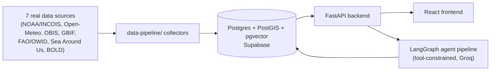

# OASIS

**AI-driven unified data platform for oceanographic, fisheries & molecular biodiversity insights.**

OASIS unifies six fragmented Indian marine data domains — oceanographic,
satellite-derived ocean products, weather, fisheries, biodiversity/species
occurrence, and molecular/eDNA — into one Postgres+PostGIS schema, then
layers a tool-constrained agentic pipeline (data cleaning → feature
engineering → prediction/forecasting → anomaly detection → explainable
recommendation) on top, surfaced through a GIS dashboard and an NL chatbot.

The full product/architecture/sprint plan lives in [`flow.md`](flow.md); the
phase-by-phase build plan actually followed is
[`OASIS_CLAUDE_CODE_BUILD_PROMPT.md`](OASIS_CLAUDE_CODE_BUILD_PROMPT.md).
This README tracks what's actually built.

## Architecture



See [`docs/architecture.md`](docs/architecture.md) for the full agent
workflow diagram and [`docs/database-schema.md`](docs/database-schema.md)
for the schema.

## Build status

| Phase | What | Status |
|---|---|---|
| 0 | Data pipeline: 8 real-data collectors, ~129K seed records | Done — schema applied and data loaded into a live Supabase project; row counts verified |
| 1 | FastAPI backend core: SQLAlchemy models, read API (6 domains), Alembic baseline | Done |
| 2 | Auth: Supabase Auth proxy + JWT verification | Done |
| 3 | React frontend: layout, auth, 6 domain explorer pages | Done |
| 4 | Feature engineering, prediction/forecasting models, anomaly detection, SHAP | Done — `backend/app/ml/`, four endpoints live, 1,375 anomalies detected. Skill vs persistence is reported honestly per model (see [`docs/model-cards.md`](docs/model-cards.md)): chlorophyll +17.5%, catch +1.5%, SST −0.0% |
| 5 | LangGraph agent pipeline, NL chatbot, pgvector RAG | Done — tool-constrained ReAct loop over the Phase 4 functions, 1,482 species embedded locally with fastembed, recommendations narrated and cached. Runs on any OpenAI-compatible provider (Groq free tier by default) |
| 6 | Correlation Studio, eDNA similarity search, SHAP viz, session export | Correlation Studio and eDNA k-mer search done; SHAP contributions are returned by the API and narrated in recommendations but not yet charted; session export still 501 |
| 7 | Deployment/CI | `render.yaml` + `frontend/vercel.json` committed and CI deploy steps wired; **needs you to create the Render service and Vercel project** — see [`docs/deployment.md`](docs/deployment.md) |
| 8 | Testing hardening | Backend: 58 pytest tests against the live database (DB/Supabase-gated, skip rather than fake). Frontend: 13 Vitest + React Testing Library tests, running in CI |
| 9 | Documentation | This file + `architecture.md`, `api-reference.md`, `database-schema.md`, `model-cards.md`, `deployment.md`, `demo-script.md` |

**On Phase 4's numbers:** the models are reported against a persistence
baseline, and two of the three barely beat it — chlorophyll forecasting is
the only clear win, and SST forecasting is no better than assuming no
change. That is a property of 8-day satellite composites with no
atmospheric forcing in the dataset, not a bug, and it is documented rather
than hidden. The component that works unambiguously well is the anomaly
detector, which found a spatially coherent basin-wide warm event across
April–May 2026. Details in [`docs/model-cards.md`](docs/model-cards.md).

**What's left:** creating the Render service and Vercel project, which
needs your accounts — `docs/deployment.md` has the six steps. Session-report
export and SHAP charts in the UI are the two remaining Should-Haves.

**The agent layer is provider-agnostic:** set `LLM_API_KEY` / `LLM_BASE_URL`
/ `LLM_MODEL` in `.env` for any OpenAI-compatible free tier. Groq by default;
Cerebras and OpenRouter work with a base-URL change and no code change.

## Setup

### 1. Data pipeline + database

```bash
pip install -r data-pipeline/requirements.txt
cp .env.example .env   # fill in DATABASE_URL, SUPABASE_* — see docs/supabase-setup.md
python backend/db/apply_schema.py --check   # verify connection + extensions
python backend/db/apply_schema.py           # create schema
python data-pipeline/cleaning/load_seeds.py # load the committed ~129K real records
```

Full walkthrough: [`docs/supabase-setup.md`](docs/supabase-setup.md).

### 2. Backend

```bash
cd backend
pip install -r requirements.txt
uvicorn app.main:app --reload   # http://localhost:8000/docs
pytest                          # DB/Supabase-gated tests skip without credentials
```

### 3. Frontend

```bash
cd frontend
cp .env.example .env   # VITE_API_BASE_URL, optionally VITE_SUPABASE_*
npm install
npm run dev             # http://localhost:5173
npm test                # Vitest + React Testing Library
```

### 4. Everything at once (local Postgres instead of Supabase)

```bash
cp .env.example .env   # SUPABASE_* still needed for auth — see docker-compose.yml's header comment
docker compose up --build
```

## Tech stack

Python/FastAPI/SQLAlchemy/Alembic backend, React/TypeScript/Vite/Tailwind
frontend, Postgres+PostGIS+pgvector on Supabase, scikit-learn/SHAP for ML
(gradient boosting via scikit-learn's HistGradientBoosting rather than the
xgboost package — same model class, no extra binary wheel on a free-tier
dyno), LangGraph + any OpenAI-compatible LLM for the agent pipeline. Full rationale in
[`flow.md` §2](flow.md#2-recommended-tech-stack).

## No synthetic data

Every number in this app traces to a real ingested record from a cited
public source (NOAA, OBIS, GBIF, FAO/OWID, Sea Around Us, BOLD, Open-Meteo) or a model
trained on one — see `data-pipeline/collectors/*.py` docstrings for each
source's API and
[`docs/developer-c-week1-flow.md`](docs/developer-c-week1-flow.md) for how
each was verified live. Tests follow the same rule: endpoint tests that
need real seeded data are DB-gated (`tests/conftest.py`) and skip — rather
than mock — when no database is configured.

## Docs

- [`docs/architecture.md`](docs/architecture.md) — agent workflow, built vs. planned
- [`docs/api-reference.md`](docs/api-reference.md) — every live endpoint
- [`docs/database-schema.md`](docs/database-schema.md) — human-readable schema + reconciliation notes
- [`docs/model-cards.md`](docs/model-cards.md) — Phase 4 models, metrics, and where they fall short
- [`docs/deployment.md`](docs/deployment.md) — Render + Vercel, and the free-tier limits that bite
- [`docs/demo-script.md`](docs/demo-script.md) — walkthrough for a live evaluation
- [`docs/supabase-setup.md`](docs/supabase-setup.md) — provisioning Supabase
- [`docs/developer-c-week1-flow.md`](docs/developer-c-week1-flow.md) — data collection/schema decisions and why
