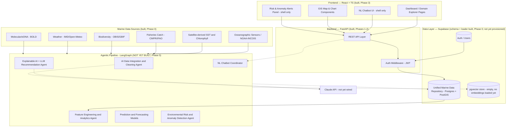
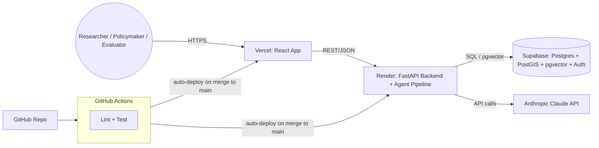

# Architecture

Mirrors the pipeline diagram from the team's original proposal (`flow.md`
§3.1) — annotated with what's actually built versus still planned, as of
this document's last update.

## Component architecture

Dashed lines mark connections that exist in the schema/API contract but
aren't live yet — the agent pipeline itself hasn't been built (Phase 5), so
those hops are unimplemented rather than broken.

## What each layer actually is right now

| Layer | State |
|---|---|
| **Data sources → `data-pipeline/collectors/`** | Live. 7 collectors, ~114K real records committed to `data-pipeline/seeds/raw/`, refreshed daily/weekly via GitHub Actions. |
| **`data-pipeline/cleaning/load_seeds.py`** | Live, deterministic. This *is* the cleaning logic Phase 5's `integration_cleaning_agent.py` will later wrap with an LLM narration layer — it isn't a placeholder, it's the reference implementation. |
| **Supabase (Postgres+PostGIS+pgvector+Auth)** | Schema (`backend/db/schema.sql`) and apply tooling exist; no project has been provisioned in this environment, so the schema has never been applied to a live database and no rows exist yet. |
| **`backend/app/` (FastAPI)** | Live. Every read endpoint in `flow.md` §11 (excluding analytics/agent) is implemented against SQLAlchemy models that mirror `schema.sql` 1:1. Auth proxies to Supabase Auth's REST API. `analytics/*` and `agent/*` are 501 stubs. |
| **`frontend/` (React)** | Live. Auth-gated shell, dashboard, and explorer pages for all six domains consume the real read API. Correlation/Risk-Alerts/Chatbot/Admin pages render but their backing endpoints are still 501s, so they show an explicit "not implemented yet" state rather than fake data. |
| **`backend/app/agents/`** | Does not exist yet. Phase 5. |
| **`backend/app/ml/`** | Does not exist yet. Phase 4. |

## Two execution modes (planned, Phase 5)

Per `flow.md` §3.1: a **Scheduled Pipeline Mode** runs Agents 1–5 in batch on
ingestion refresh; an **Interactive Mode** lets the NL Chatbot Coordinator
invoke Agents 2–5 as callable tools during a chat turn. Both will share the
same underlying deterministic functions (`data-pipeline/cleaning/`,
Phase 4's `backend/app/ml/`) — the LLM layer selects and narrates, it never
generates arbitrary SQL or code (see `flow.md`'s risk-mitigation table,
§15).

## Deployment architecture (planned, Phase 7)

`backend-ci.yml` / `frontend-ci.yml` exist and run lint+test/build on every
push; the deploy steps are present but no-op until `RENDER_DEPLOY_HOOK_URL`
/ `VERCEL_TOKEN` repo secrets are set, since no Render/Vercel projects have
been created for this app yet. `docker-compose.yml` at the repo root gives
a local full-stack alternative (local Postgres+PostGIS+pgvector instead of
Supabase; Auth still requires a real Supabase project since Supabase Auth's
REST API isn't something local Postgres replicates).
