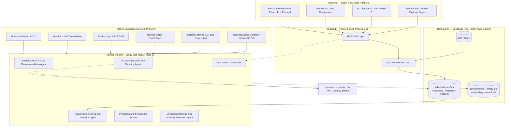
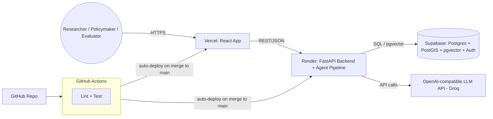

# Architecture

Mirrors the pipeline diagram from the team's original proposal (`flow.md`
§3.1) — annotated with what's actually built versus still planned, as of
this document's last update.

## Component architecture

Dashed lines mark connections that exist in the contract but aren't live.
As of Phase 6 the only remaining ones are session-report export and SHAP
charting in the UI.

## What each layer actually is right now

| Layer | State |
|---|---|
| **Data sources → `data-pipeline/collectors/`** | Live. 8 collectors, ~129K real records committed to `data-pipeline/seeds/raw/`. Six are refreshed daily/weekly via GitHub Actions; `sea_around_us.py` is a versioned historical reconstruction (1950–2019) and is pulled by hand, since polling it could never return anything new. |
| **`data-pipeline/cleaning/load_seeds.py`** | Live, deterministic. This *is* the cleaning logic Phase 5's `integration_cleaning_agent.py` will later wrap with an LLM narration layer — it isn't a placeholder, it's the reference implementation. |
| **Supabase (Postgres+PostGIS+pgvector+Auth)** | Live. Schema applied (19 tables incl. `alembic_version`), ~103K rows loaded across all six domains, Alembic at revision `0003`. `embeddings` is still empty — that is Phase 5. |
| **`backend/app/` (FastAPI)** | Live. Every read endpoint in `flow.md` §11 (excluding analytics/agent) is implemented against SQLAlchemy models that mirror `schema.sql` 1:1. Auth proxies to Supabase Auth's REST API. `analytics/*` and `agent/*` are fully live; the only remaining 501s are `/api/agent/report` (session export) and `/api/admin/sync`. |
| **`frontend/` (React)** | Live. Auth-gated shell, dashboard, and explorer pages for all six domains consume the real read API. Risk & Anomaly Alerts lists real detected events with station and value-vs-threshold, the Chatbot answers with rendered tool citations, Correlation Studio plots a live scatter with its caveats, and the Molecular page runs barcode similarity search. |
| **`backend/app/agents/`** | Live. LangGraph ReAct loop over ten typed tools (`tools.py`), pgvector RAG with locally-generated fastembed vectors, and the recommendation agent. The model selects and narrates; it never computes and cannot emit SQL. |
| **`backend/app/ml/`** | Live. Feature engineering, ocean forecasting, catch prediction, anomaly detection and SHAP, behind four `/api/analytics/*` endpoints. Artifacts in `ml-models/artifacts/`, trained by `python -m app.ml.registry`. Metrics — including where models fail to beat a persistence baseline — in `docs/model-cards.md`. |

## Two execution modes (built)

Per `flow.md` §3.1: **Scheduled Pipeline Mode** runs the deterministic stages
in batch (`load_seeds.py`, `python -m app.ml.registry`, `anomalies.run_all`)
to populate the database; **Interactive Mode** lets the NL Chatbot
Coordinator invoke the same functions as tools during a chat turn. Both share
the same underlying deterministic functions (`data-pipeline/cleaning/`,
Phase 4's `backend/app/ml/`) — the LLM layer selects and narrates, it never
generates arbitrary SQL or code (see `flow.md`'s risk-mitigation table,
§15).

## Deployment architecture (config committed, not yet live)

`render.yaml` and `frontend/vercel.json` describe both services, and
`backend-ci.yml` / `frontend-ci.yml` run lint+test/build on every push. The
deploy steps no-op until `RENDER_DEPLOY_HOOK_URL` / `VERCEL_TOKEN` repo
secrets are set, which requires creating the Render and Vercel projects —
see `docs/deployment.md`. `docker-compose.yml` at the repo root gives
a local full-stack alternative (local Postgres+PostGIS+pgvector instead of
Supabase; Auth still requires a real Supabase project since Supabase Auth's
REST API isn't something local Postgres replicates).
