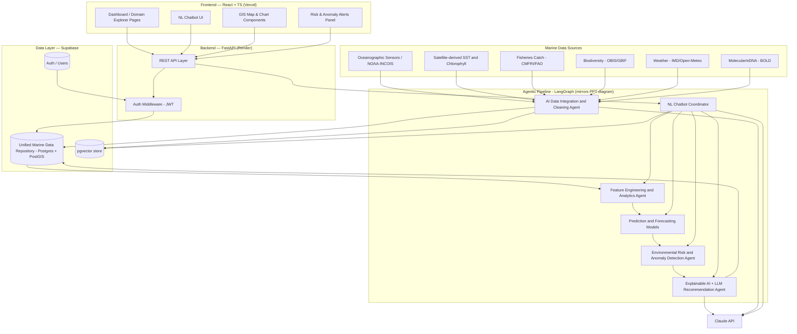
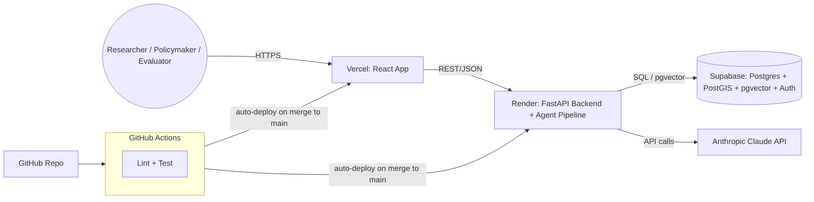
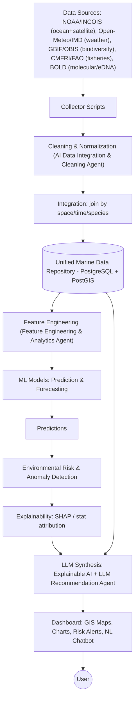
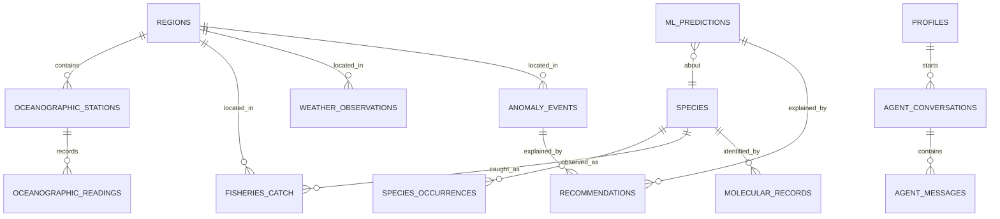

# OASIS — AI-Driven Unified Data Platform for Oceanographic, Fisheries & Molecular Biodiversity Insights Using Agentic AI
## Complete 5-Week Project Execution Plan

**Context.** This plan is built from the team's actual presentation (Siddh Shah, Anadya Sharma, Vedika Shetty), which frames this as a CMLRE/INCOIS/CMFRI-style Indian marine-data problem: research data is fragmented across **six** domains — oceanographic, fisheries, biodiversity, weather, satellite, and molecular/genomic (eDNA) — held by separate agencies with no unified, AI-driven, explainable, conversational platform. The literature review explicitly frames prior work (fisheries-only DSS, image-only fish classifiers, species-ID-only tools) as too narrow; the differentiator this project must deliver is **breadth + agentic automation + explainability + natural language**, not depth in any single narrow ML task. The proposed-solution slide gives an explicit pipeline — `Sources → Unified Marine Data Repository → AI Data Integration & Cleaning Agent → Feature Engineering & Analytics Agent → Prediction & Forecasting Models → Environmental Risk & Anomaly Detection → Explainable AI + LLM Recommendation Agent → Interactive Dashboard & NL Chatbot` — and this plan's architecture, agent design, and module naming are deliberately mirrored to that diagram so the build is traceable back to the slide the team will be evaluated against.

Two scope calls were necessary to make six domains + agentic ETL + anomaly detection + XAI + NL chat feasible for 3 developers in 5 weeks, and are treated as settled decisions for the rest of this plan:
- **Satellite** data is delivered as satellite-derived oceanographic variables (SST, chlorophyll-a from NOAA/INCOIS/Copernicus products) rather than a separate raw-imagery subsystem — this genuinely satisfies "integrate satellite data" without a standalone remote-sensing pipeline.
- **Molecular/biodiversity** scope is eDNA/genomic barcode data (per the objectives slide, "molecular (eDNA/genomic) datasets"), not image/otolith classification — the literature review cites image-based fish classifiers as an example of the narrow prior work this platform must surpass, so a CV classifier is explicitly **not** the differentiator here and is pushed to Future Scope.
- "Agentic AI automates ingestion/cleaning/feature engineering" is implemented as **constrained, tool-using LLM agents** (the agent picks from a fixed library of cleaning/mapping/feature functions and explains its choices) rather than a fully autonomous, freeform-code-writing agent — this is what makes the objective achievable and reliable in 5 weeks instead of a research project in itself.

---

## 1. Product Understanding

### Problem Summary
India's marine data — oceanographic sensor readings, satellite-derived ocean products, fisheries catch/landing statistics, biodiversity/species occurrence records, weather observations, and molecular/genomic (eDNA) biodiversity data — is generated and held by different organizations (INCOIS, CMFRI, CMLRE, NIO, NCCR, IMD, NOAA/Copernicus) in incompatible formats with no shared platform. This makes integration, ecosystem monitoring, and predictive analysis slow and manual. Existing tools are narrow and single-purpose (fisheries-only DSS, image-only fish classifiers, satellite-only fishing-zone advisories) and none offer predictive analytics, anomaly detection, explainable AI, or natural-language access in one place — so researchers and policymakers cannot ask cross-domain questions or get automated, explained, actionable insight.

### MVP Definition (Must ship for demo)
A web platform that:
1. Ingests and normalizes **real public data** across all six named domains (oceanographic, weather, satellite-derived ocean products, fisheries, biodiversity/species occurrence, molecular/eDNA) into one relational schema, via a pipeline where an LLM-assisted **Data Integration & Cleaning Agent** does the schema-mapping/normalization/quality-flagging work (constrained to a fixed toolset, not freeform).
2. Runs a **Feature Engineering & Analytics Agent** that derives the joined, engineered features (spatial/temporal joins, rolling stats, diversity indices) the ML layer needs.
3. Runs **Prediction & Forecasting models** for (a) fish stock/catch and (b) short-horizon ocean-condition forecasting (e.g., SST/chlorophyll N days ahead).
4. Runs **Environmental Risk & Anomaly Detection** flagging marine heatwaves, harmful-algal-bloom-like chlorophyll spikes, and biodiversity-decline trends using simple, reliable statistical methods (rolling z-score / percentile thresholds against climatology).
5. Runs an **Explainable AI + LLM Recommendation Agent** that turns a prediction/anomaly + its feature attributions into a plain-language, actionable recommendation.
6. Presents an **Interactive Dashboard & GIS Map** across all domains, plus an **NL Chatbot** that can answer data questions and surface predictions/anomalies/recommendations conversationally, reusing the same agents as callable tools.
7. Is deployed on a public URL with auth, ready for live demo.

### Should-Have Features (build if the Must-Haves land on schedule)
- Interactive eDNA/genomic barcode similarity search tool (submit a sequence, get likely species matches) on top of the ingested molecular records.
- Cross-domain "Correlation Studio" (pick any two variables across domains, get a scatter/heatmap + agent-narrated correlation).
- Downloadable session report from the Recommendation Agent (PDF/Markdown export of a conversation's findings).
- SHAP-style feature-importance visualizations surfaced directly in the UI (not just narrated in chat).

### Nice-to-Have Features
- Multivariate anomaly detection (Isolation Forest) as an upgrade to the rolling-threshold method.
- Mobile-responsive polish.
- Admin data-source health dashboard with manual re-sync trigger.

### Future Scope (explicitly out of the 5-week window)
- Image/otolith-based species classification (CV) — deliberately excluded per the literature-review framing that this is what narrow prior work already does; not this project's differentiator.
- Live/streaming ingestion from institutional real-time APIs (Copernicus Marine, INCOIS real-time feeds).
- Full genomic alignment pipeline (actual BLAST-style matching against NCBI/BOLD, phylogenetic tree construction) beyond simple k-mer/sequence similarity.
- Multi-institution federated data sharing / role-based data governance.
- Mobile app / offline field-data-collection companion.
- Multi-tenant SaaS with per-institution access control and billing.
- MLOps: scheduled retraining, drift detection.

---

## 2. Recommended Tech Stack

| Layer | Choice | Why |
|---|---|---|
| **Backend** | Python + **FastAPI** | Async, auto-generated OpenAPI docs, native fit with the Python ML/data/agent stack (pandas, scikit-learn, LangGraph) — no cross-language glue code under time pressure. |
| **Frontend** | **React + TypeScript + Vite**, TailwindCSS + shadcn/ui | Fast dev loop and polished components out of the box, so the team gets a good-looking six-domain dashboard without building a design system from scratch. |
| **Database** | **PostgreSQL + PostGIS**, hosted on **Supabase** | One managed free-tier service gives Postgres + PostGIS (geospatial queries) + **pgvector** + Auth + storage — consolidating four infra needs into one free service is the single biggest time-saver in a 5-week build with six data domains to house. |
| **ML** | **scikit-learn / XGBoost** for fish-stock/catch prediction and short-horizon forecasting (lag-feature regression); simple **rolling z-score / percentile** anomaly detection (optionally upgraded to **Isolation Forest**); **SHAP** for explainability | Gradient-boosted trees and statistical anomaly thresholds are fast to train/tune, robust to messy real-world data, and directly explainable — far lower risk than deep learning for this timeline, while still satisfying the "predict fish stock/biodiversity/ocean changes" and "detect anomalies" objectives literally. |
| **Agentic AI** | **LangGraph** for the five-agent pipeline (Integration & Cleaning, Feature Engineering & Analytics, Prediction & Forecasting, Risk & Anomaly Detection, Explainable AI + LLM Recommendation) + **Claude API** (Sonnet for synthesis/recommendation, Haiku for cheap constrained sub-agent calls) | LangGraph gives an explicit, debuggable agent graph that maps 1:1 onto the PPT's named pipeline stages — important both for reliability under time pressure and for being able to show evaluators "this box in our diagram is this agent." Agents are tool-constrained (fixed cleaning/feature functions, fixed query templates) rather than freeform-code-generating, which is what keeps "agentic ingestion" achievable in 5 weeks. |
| **Vector DB** | **pgvector** (inside the same Supabase Postgres instance) | Avoids a separate vector database service; sufficient at MVP scale for taxonomy/species knowledge embeddings backing the NL chatbot. |
| **Deployment** | Frontend → **Vercel**; Backend → **Render**; DB/Auth/Vector → **Supabase** — all free tier | Zero-cost, git-push-to-deploy, public URL from Week 1 instead of a Week 5 scramble. |
| **Authentication** | **Supabase Auth** (email/password + magic link), JWT verified in FastAPI middleware | Comes free with the DB choice; no separate auth service to hand-roll. |
| **Visualization** | **Recharts** (time series, KPIs) + **Plotly.js** (correlation heatmaps, anomaly charts) | Recharts is fastest for standard charts; Plotly is used only where its statistical chart types save real time over hand-rolling. |
| **Maps** | **React-Leaflet** + OpenStreetMap tiles + GeoJSON overlays | Free, no API key, integrates cleanly with PostGIS GeoJSON output — sufficient for the "Interactive Dashboard & GIS Maps" feature across all six domains. |

---

## 3. Software Architecture

### 3.1 Component Architecture — mirrors the PPT's proposed-solution pipeline



**Two execution modes, same five pipeline agents:** a **Scheduled Pipeline Mode** runs Agents 1–5 in batch (on ingestion refresh) to populate the database with cleaned data, engineered features, predictions, anomalies, and recommendations that back the dashboard; an **Interactive Mode** lets the NL Chatbot Coordinator invoke Agents 2–5 on demand as callable tools when a user asks a specific question in chat. This resolves the PPT's dual framing of agents as both automating ETL *and* powering the conversational interface.

### 3.2 Deployment Architecture



---

## 4. Development Flow (Fastest Path to a Working MVP)

Build order optimizes for the **earliest end-to-end vertical slice through the whole pipeline**, then widens domain coverage and agent sophistication — not for finishing one layer in isolation.

1. **Repo, infra, and schema skeleton (Days 1–2).** Supabase project, FastAPI skeleton, React skeleton, CI/CD to Vercel+Render, all talking to each other via one dummy endpoint, before any feature work. Deployment plumbing is the #1 hidden time sink; doing it Day 1 removes Week 5 surprises.
2. **Freeze the unified DB schema across all six domains (Days 2–3, whole team).** Tables for ocean readings, weather, satellite-derived products, species occurrences, fisheries catch, and molecular records, designed together in one session, since every module below depends on it.
3. **Deterministic ingestion connectors, one domain at a time (Days 3–7).** Oceanographic + satellite-derived first (simplest, from NOAA/INCOIS/OBIS env layers), then weather (Open-Meteo/IMD), then species occurrence (GBIF/OBIS), then fisheries (CMFRI/FAO public data), then molecular/eDNA (BOLD). These connectors are plain reliable scripts — the "agentic" layer (step 4) sits *on top* of them for cleaning/mapping intelligence, not in place of them, so ingestion never depends on an LLM being available.
4. **Wrap ingestion with the Data Integration & Cleaning Agent (end of Week 1 into Week 2).** The agent uses a fixed toolset (unit conversion, column-mapping, outlier/missing-value flagging) plus an LLM call to explain/label what it did — this is what makes ingestion genuinely "agentic" per the objectives without being an autonomous scraper-writer.
5. **Minimal read API + minimal dashboard showing real data on a GIS map (end of Week 1).** First end-to-end vertical slice and Week 1's demo — proves the whole stack before any ML/agent complexity is added.
6. **Cross-domain query API + full dashboard across all six domains (Week 2).** Filtering, spatial/temporal joins, charts per domain — the foundation the Feature Engineering Agent and ML layer sit on.
7. **Feature Engineering & Analytics Agent + Prediction & Forecasting models (Week 3).** Only attempted once the joined dataset exists, since features come directly from the unified schema; fish-stock/catch prediction first (simpler tabular target), ocean-condition forecasting second.
8. **Environmental Risk & Anomaly Detection (Week 3–4).** Rolling z-score/percentile detectors over SST, chlorophyll, and species-occurrence trend data — reuses the same joined feature tables as step 7, so it is cheap to add once that exists.
9. **Explainable AI + LLM Recommendation Agent, and NL Chatbot (Week 3–4).** Start with the chatbot answering simple NL→SQL data questions (one agent, one tool) in Week 3, then wire it up to call the Prediction, Anomaly, and Recommendation agents as tools in Week 4 — always keep a working chat feature and layer capability on incrementally.
10. **Should-Have modules: eDNA similarity search, Correlation Studio (Week 4).** Deliberately last and time-boxed — highest-risk, most cuttable, dropped without harming the core MVP if behind schedule.
11. **Integration hardening, polish, deployment freeze, docs, demo rehearsal (Week 5).** No new features — only fixes, UX polish, and making the hosted demo bulletproof.

---

## 5. GitHub Repository Structure

```
OASIS/
├── .github/
│   └── workflows/
│       ├── backend-ci.yml          # lint/test/deploy backend on push to main
│       └── frontend-ci.yml         # lint/build/deploy frontend on push to main
├── backend/
│   ├── app/
│   │   ├── api/                    # FastAPI routers: ocean, weather, satellite, species, fisheries, molecular, analytics, agent
│   │   ├── core/                   # config, settings, security/JWT verification
│   │   ├── db/                     # SQLAlchemy models, session, migrations (Alembic)
│   │   ├── agents/                 # one file per PPT-pipeline agent + graph.py orchestrator
│   │   │   ├── integration_cleaning_agent.py
│   │   │   ├── feature_engineering_agent.py
│   │   │   ├── prediction_forecasting_agent.py
│   │   │   ├── anomaly_detection_agent.py
│   │   │   ├── explainable_recommendation_agent.py
│   │   │   ├── nl_chatbot_coordinator.py
│   │   │   └── graph.py
│   │   ├── ml/                     # model training scripts, inference wrappers, SHAP utils
│   │   ├── schemas/                # Pydantic request/response models
│   │   └── services/               # business logic shared across routers/agents
│   ├── tests/                      # pytest unit/integration tests
│   ├── alembic/                    # DB migration history
│   ├── requirements.txt
│   └── Dockerfile
├── data-pipeline/
│   ├── collectors/                 # one script per source: noaa_incois.py, open_meteo.py, gbif_obis.py, cmfri_fao.py, bold.py
│   ├── cleaning/                   # deterministic normalization + schema-mapping (the tools the Cleaning Agent calls)
│   ├── notebooks/                  # exploratory analysis, model prototyping (not production code)
│   └── seeds/                      # cached raw + cleaned snapshots for reproducible local dev
├── frontend/
│   ├── src/
│   │   ├── pages/                  # Dashboard, OceanExplorer, WeatherExplorer, SpeciesExplorer, Fisheries, Molecular, Correlation, RiskAlerts, Chatbot, Admin
│   │   ├── components/             # MapView, TimeSeriesChart, AnomalyBadge, RecommendationCard, ChatWindow, KPITile, etc.
│   │   ├── api/                    # typed API client functions
│   │   ├── hooks/                  # data-fetching and auth hooks
│   │   ├── store/                  # lightweight state (Zustand or React context)
│   │   └── types/                  # shared TypeScript types (mirrors backend Pydantic schemas)
│   ├── public/
│   └── package.json
├── ml-models/
│   └── artifacts/                  # versioned trained model files
├── docs/
│   ├── architecture.md
│   ├── api-reference.md
│   ├── database-schema.md
│   └── demo-script.md
├── docker-compose.yml              # local full-stack spin-up: postgres, backend, frontend
├── .env.example
└── README.md
```

**Purpose notes:** `data-pipeline/cleaning/` holds the deterministic functions; `backend/app/agents/integration_cleaning_agent.py` is the thin LLM layer that *selects and narrates* which of those functions to apply — keeping the "agentic" behavior auditable and separate from the reliable mechanics it orchestrates. `ml-models/artifacts/` is separated from `backend/app/ml/` so trained model binaries are versioned/deployed independently of application code.

---

## 6. Module Breakdown

| Module | Purpose | Priority | Dependencies | Difficulty | Owner |
|---|---|---|---|---|---|
| Deterministic Ingestion Connectors | Pull real data for all 6 domains (NOAA/INCOIS, Open-Meteo/IMD, GBIF/OBIS, CMFRI/FAO, BOLD) | Must | None | Medium | Dev C |
| Unified DB Schema | Single relational schema joining all 6 domains | Must | Connectors (inform fields) | Medium | Dev C + whole team (design) |
| Backend Core API | CRUD/query REST endpoints over the schema | Must | DB Schema | Medium | Dev A |
| Auth & User Mgmt | Login/session via Supabase Auth | Must | Supabase setup | Low | Dev B |
| Frontend Shell & Nav | Routing, layout, auth-gated pages | Must | None (parallel) | Low | Dev B |
| GIS Map & Viz Components | Reusable map/chart components across domains | Must | Core API | Medium | Dev B |
| Data Integration & Cleaning Agent | LLM-assisted, tool-constrained cleaning/mapping layer over the connectors | Must | Connectors | Medium | Dev C |
| Feature Engineering & Analytics Agent | Derives joined/engineered features (space/time joins, rolling stats, diversity indices) | Must | Unified DB | Medium | Dev A |
| Prediction & Forecasting Models | Fish-stock/catch prediction + short-horizon ocean forecasting | Must | Feature Engineering Agent | Medium-High | Dev A |
| Environmental Risk & Anomaly Detection Agent | Flags heatwave/HAB-like/biodiversity-decline anomalies | Must | Feature Engineering Agent | Medium | Dev A |
| Explainable AI + LLM Recommendation Agent | SHAP/stat explanation → narrated, actionable recommendation | Must | Prediction + Anomaly agents | Medium | Dev C |
| Vector DB / RAG | pgvector store + retrieval for taxonomy/knowledge grounding | Must | Ingested species/taxonomy text | Medium | Dev C |
| NL Chatbot Coordinator + Chat UI | Conversational interface invoking the agent pipeline as tools | Must | All pipeline agents | High | Dev B (UI) + Dev C (orchestration) |
| Risk & Anomaly Alerts UI | Dashboard panel surfacing anomaly/recommendation output | Must | Anomaly + Recommendation agents | Low-Medium | Dev B |
| Correlation Studio | Cross-domain variable correlation view | Should | Feature Engineering Agent | Medium | Dev A + Dev B |
| eDNA/Molecular Similarity Search | Barcode sequence similarity search UI + endpoint | Should | Molecular data ingested | Medium | Dev C |
| Session Report Export | Downloadable summary of a chat session's findings | Should | Recommendation Agent | Low | Dev B |
| Deployment/DevOps/CI | Hosting, CI/CD, environment config | Must | All modules (ongoing) | Medium | Dev C |
| Documentation | Architecture, API, demo script | Must | Near-complete features | Low | All |

---

## 7. Five-Week Sprint Plan

### Week 1 — Foundations & First Vertical Slice
- **Sprint Goal:** Real oceanographic + satellite-derived data flowing end-to-end into the unified DB, visible on a deployed, auth-gated GIS dashboard.
- **Modules:** Deterministic connectors (ocean + satellite-derived domains), Unified DB Schema (all 6 domains designed), Backend Core API skeleton, Auth, Frontend Shell, Deployment pipeline.
- **Deliverables:** Live Vercel + Render URLs; Supabase schema created & migrated for all 6 domains; oceanographic/satellite data ingested and queryable; login works; dashboard shows a GIS map with real station points.
- **Integration Points:** Backend ↔ Supabase verified; Frontend ↔ Backend auth flow verified; CI auto-deploys on merge to `main`.
- **Testing:** Manual smoke test of signup/login; pytest for one ingestion connector; API endpoint returns real data.
- **Definition of Done:** A logged-in user sees a real GIS map of oceanographic stations from a public dataset, hosted on a public URL.
- **Demo:** Live URL walkthrough — login, GIS map with real ocean station data.
- **Documentation:** `docs/database-schema.md` v1 (all 6 domains), `.env.example`, setup instructions in README.
- **Risks:** Infra setup eats more time than expected → mitigate by doing it Day 1 with all 3 devs together, not sequentially.

### Week 2 — Full Six-Domain Ingestion + Cleaning Agent + Dashboard
- **Sprint Goal:** All six domains ingested and explorable, with the Data Integration & Cleaning Agent live on top of the connectors.
- **Modules:** Weather, biodiversity/species, fisheries, and molecular/eDNA connectors; Data Integration & Cleaning Agent; cross-domain query API; GIS Map & Viz components; page shells for each domain explorer.
- **Deliverables:** Open-Meteo/IMD, GBIF/OBIS, CMFRI/FAO, and BOLD data loaded and cleaned via the agent; filterable map + time-series charts per domain; navigation across all domain pages.
- **Integration Points:** Frontend explorer pages consume the new query API; PostGIS spatial queries validated; Cleaning Agent's output (cleaning notes/flags) visible via `datasets_metadata`.
- **Testing:** API integration tests for filter/query params; agent output spot-checked against known bad records to confirm flagging works.
- **Definition of Done:** A user can filter and view real, cleaned data across all six domains spatially and over time in the dashboard.
- **Demo:** Live filtering across all six domain explorer pages, plus a look at the Cleaning Agent's data-quality notes.
- **Documentation:** `docs/api-reference.md` v1.
- **Risks:** Public datasets across 6 sources are inconsistent in format/units → mitigate with a buffer day for cleaning, and by scoping each domain to a curated regional subset rather than a global dump.

### Week 3 — Feature Engineering, Prediction, Forecasting
- **Sprint Goal:** The Feature Engineering & Analytics Agent producing joined features, and working Prediction & Forecasting models on top of them.
- **Modules:** Feature Engineering & Analytics Agent, Prediction & Forecasting Models (fish-stock/catch + ocean-condition forecasting), pgvector setup + initial taxonomy embeddings, NL Chatbot v1 (single agent, NL→SQL only).
- **Deliverables:** `/api/analytics/predict` (catch) and `/api/analytics/forecast` (ocean conditions) endpoints; chatbot answering "what is X in region Y" style questions; embeddings loaded into pgvector.
- **Integration Points:** Feature Engineering Agent output feeds directly into both prediction models; Chat UI wired to `/api/agent/chat`.
- **Testing:** Models evaluated on a held-out split (accuracy/RMSE reported in docs); manual QA of 10+ sample chat queries for correctness.
- **Definition of Done:** User can ask a natural-language data question and get a correct, DB-grounded answer; prediction and forecast endpoints return sensible values for real inputs.
- **Demo:** Chatbot answering live questions + a prediction/forecast chart.
- **Documentation:** Model cards (features, target, metrics) in `docs/`.
- **Risks:** NL→SQL generation producing incorrect/unsafe queries → constrain the chatbot's data-lookup tool to a fixed set of parameterized query templates, never freeform SQL.

### Week 4 — Anomaly Detection, Explainable Recommendations, Full Chatbot, Should-Haves
- **Sprint Goal:** Environmental Risk & Anomaly Detection and the Explainable AI + LLM Recommendation Agent live, chatbot able to invoke the full pipeline, plus Should-Have modules if on schedule.
- **Modules:** Environmental Risk & Anomaly Detection Agent, Explainable AI + LLM Recommendation Agent, NL Chatbot v2 (calls Prediction/Anomaly/Recommendation agents as tools), Risk & Anomaly Alerts UI, Correlation Studio and/or eDNA similarity search (pick based on buffer remaining).
- **Deliverables:** Anomaly detection flagging heatwave/HAB-like/biodiversity-decline events; recommendation agent narrating predictions and anomalies with plain-language, actionable text; chatbot answering compound questions ("is there a heatwave risk in region X, and what should we do?"); at least one Should-Have module working end-to-end.
- **Integration Points:** Chatbot Coordinator routes across all pipeline agents; Risk & Anomaly Alerts UI and Correlation Studio call the same analytics service the chatbot uses (no duplicated logic).
- **Testing:** Scripted end-to-end QA of ~15 representative demo questions; regression check that Week 3's simple chat queries still work; anomaly detector spot-checked against a known historical event (e.g., a documented marine heatwave period) if data permits.
- **Definition of Done:** The chatbot can answer a multi-hop question spanning data lookup + prediction/anomaly + recommendation in one response; the dashboard surfaces at least one real anomaly alert with an explained recommendation.
- **Demo:** Full "wow" demo — anomaly alert → explained recommendation → chatbot follow-up question.
- **Documentation:** Agent workflow diagram finalized in `docs/architecture.md`.
- **Risks:** Agent graph complexity causing slow/flaky responses → cap agent hop count, add per-agent timeouts with graceful fallback text, keep the Week 3 single-agent chat path as a manual fallback if the full graph isn't stable by Thursday.

### Week 5 — Integration Hardening, Polish, and Demo Prep
- **Sprint Goal:** Ship a bulletproof, polished MVP with no new features — only fixes, polish, and demo readiness.
- **Modules:** Cross-module bug fixing, UI/UX polish pass, deployment freeze, documentation completion, demo rehearsal.
- **Deliverables:** Final deployed app; complete `docs/` set; demo script + backup recorded video; seeded/cached demo data and pre-warmed agent responses to avoid live-demo flakiness.
- **Integration Points:** Full regression pass across every page and every agent path.
- **Testing:** End-to-end manual test checklist (§14) run twice by different team members; load-check the hosted backend doesn't cold-start awkwardly mid-demo.
- **Definition of Done:** Every item in the Must-Have checklist (§14) is verified working on the live production URL.
- **Demo:** Final dress-rehearsal demo to the full team before the real evaluation.
- **Documentation:** README finalized with setup + demo instructions; architecture doc finalized.
- **Risks:** Free-tier backend cold starts causing a laggy live demo → ping the backend a few minutes before the demo, and have the backup video ready regardless.

---

## 8. Team Allocation

| Week | Developer A | Developer B | Developer C | Collaboration / Merge Points |
|---|---|---|---|---|
| 1 | Backend API skeleton, ML env setup | Frontend shell, Auth integration | DB schema (all 6 domains), ocean/satellite connectors, deploy pipeline | Day 1–2: all three co-design the 6-domain DB schema. End of week: merge to `main`, verify live URL together. |
| 2 | Cross-domain query API | Map & chart components, domain explorer pages | Weather/species/fisheries/molecular connectors, Data Integration & Cleaning Agent | Mid-week: Dev A + Dev C sync on query API contract before Dev B builds against it. End of week: integration merge + demo rehearsal. |
| 3 | Feature Engineering Agent, Prediction & Forecasting models | Chat UI shell, dashboard polish | pgvector/RAG setup, NL Chatbot v1 (NL→SQL) | Dev A + Dev C pair mid-week to expose model inference as a chatbot tool. End of week: merged demo of chat + prediction/forecast. |
| 4 | Anomaly Detection Agent, stretch: Correlation Studio | Risk & Anomaly Alerts UI, Chat UI polish, wiring full agent graph to frontend | Explainable AI + LLM Recommendation Agent, NL Chatbot v2, stretch: eDNA similarity search | Dev B + Dev C pair mid-week to wire chat UI to the expanded agent graph. All three pick Should-Have modules together based on Week 1–3 buffer. |
| 5 | Bug fixes (ML/agent paths), demo data prep | Bug fixes (UI/UX polish), demo rehearsal lead | Bug fixes (infra/deploy), docs lead | Full-team regression testing pass; joint demo rehearsal; joint go/no-go on any last feature cuts. |

Each developer keeps a coherent thread (A: ML/analytics/agents-that-compute, B: frontend/UX, C: data/infra/agents-that-orchestrate) while staying balanced full-stack — everyone touches integration points weekly, and the schema/API contracts are the explicit merge points that prevent silent divergence.

---

## 9. Data Flow



---

## 10. AI Agent Workflow

| Agent | Purpose | Inputs | Outputs | Dependencies | Execution Order |
|---|---|---|---|---|---|
| **AI Data Integration & Cleaning Agent** | Selects and applies cleaning/unit-conversion/schema-mapping tools over raw connector output; flags/explains anomalies in the *data itself* (missing, out-of-range, duplicate) | Raw connector output (6 domains) | Cleaned rows written to the unified repository + a data-quality note per batch | Deterministic ingestion connectors | 1st — batch mode, on ingestion refresh |
| **Feature Engineering & Analytics Agent** | Derives joined/engineered features: spatial-temporal joins across domains, rolling averages, biodiversity diversity indices | Unified repository | Feature tables used by prediction/anomaly models | Integration & Cleaning Agent | 2nd — batch mode; also callable on-demand by the chatbot |
| **Prediction & Forecasting Models** | Predicts fish-stock/catch volume and forecasts short-horizon ocean conditions (SST/chlorophyll) | Engineered features | Predictions + forecasts, stored with confidence | Feature Engineering Agent | 3rd — batch mode; also callable on-demand |
| **Environmental Risk & Anomaly Detection Agent** | Flags marine-heatwave-like SST anomalies, HAB-like chlorophyll spikes, and biodiversity-decline trends via rolling z-score/percentile thresholds | Engineered features + predictions | Anomaly events with severity | Feature Engineering Agent, Prediction models | 4th — batch mode; also callable on-demand |
| **Explainable AI + LLM Recommendation Agent** | Converts SHAP/statistical attribution for a prediction or anomaly into a plain-language, actionable recommendation | Prediction/anomaly + feature attribution | NL recommendation, stored and shown in UI/chat | Prediction models, Anomaly Detection Agent | 5th — batch mode (pre-generates recommendations for dashboard) and on-demand (chat) |
| **NL Chatbot Coordinator** | Classifies user intent, invokes Agents 2–5 as tools, retrieves knowledge via pgvector, synthesizes one final NL answer with citations | User message + conversation history | Final NL response | All pipeline agents, pgvector store | Entry point for Interactive Mode; wraps the above agents as callable tools |

**Execution flow — Scheduled Pipeline Mode:** Integration & Cleaning Agent runs on ingestion refresh → Feature Engineering & Analytics Agent → Prediction & Forecasting Models → Environmental Risk & Anomaly Detection Agent → Explainable AI + LLM Recommendation Agent → results written back to the repository and surfaced on the dashboard automatically.

**Execution flow — Interactive Mode (chat):** User message → NL Chatbot Coordinator classifies intent → dispatches to the relevant agent(s) (data lookup via a constrained query tool, and/or Feature Engineering/Prediction/Anomaly/Recommendation agents as needed) → Coordinator synthesizes one final response with citations. Each agent has a hard timeout with a graceful fallback to keep the chat responsive during the live demo.

---

## 11. API Planning

**Auth**
- `POST /auth/signup`
- `POST /auth/login`
- `POST /auth/logout`
- `GET /auth/me`

**Oceanographic (incl. satellite-derived)**
- `GET /api/ocean/stations`
- `GET /api/ocean/readings?station_id&start_date&end_date`
- `GET /api/ocean/readings/summary?region&variable`

**Weather**
- `GET /api/weather/observations?region&start_date&end_date`

**Biodiversity / Species**
- `GET /api/species`
- `GET /api/species/{species_id}`
- `GET /api/species/occurrences?bbox&start_date&end_date&species_id`

**Fisheries**
- `GET /api/fisheries/catch?region&species&start_date&end_date`
- `GET /api/fisheries/summary?region`

**Molecular / eDNA**
- `GET /api/molecular/records?species_id`
- `POST /api/molecular/match` (sequence similarity search — Should Have)

**Analytics (Prediction / Forecasting / Anomaly / Explainability)**
- `GET /api/analytics/predict/catch?...features`
- `GET /api/analytics/forecast/ocean-conditions?station_id&horizon`
- `GET /api/analytics/anomalies?region&domain&start_date&end_date`
- `GET /api/analytics/explain/{prediction_id}`
- `GET /api/analytics/recommendation/{prediction_or_anomaly_id}`
- `GET /api/analytics/correlation?var1&var2&region` (Should Have — Correlation Studio)

**Agentic AI / Chat**
- `POST /api/agent/chat`
- `GET /api/agent/conversations/{conversation_id}`
- `POST /api/agent/report` (Should Have — downloadable session summary)

**Admin / Data Ops** (internal)
- `POST /api/admin/sync/{source}`
- `GET /api/admin/datasets/status`

---

## 12. Database Planning

### 12.1 Tables

| Table | Key Columns | Notes |
|---|---|---|
| `profiles` | `user_id` (FK to Supabase auth.users), `role`, `institution` | Extends Supabase's built-in auth user table |
| `regions` | `region_id` PK, `name`, `geometry` (PostGIS polygon) | Shared spatial reference across domains |
| `oceanographic_stations` | `station_id` PK, `name`, `lat`, `lon`, `region_id` FK | |
| `oceanographic_readings` | `id` PK, `station_id` FK, `timestamp`, `sst`, `salinity`, `chlorophyll_a`, `dissolved_oxygen`, `ph`, `source` | Houses satellite-derived SST/chlorophyll alongside in-situ readings, distinguished by `source` |
| `weather_observations` | `id` PK, `region_id` FK, `timestamp`, `air_temp`, `wind_speed`, `precipitation`, `pressure`, `source` | |
| `species` | `species_id` PK, `scientific_name`, `common_name`, `taxonomy_kingdom..species`, `iucn_status` | |
| `species_occurrences` | `id` PK, `species_id` FK, `lat`, `lon`, `timestamp`, `depth`, `basis_of_record`, `source` | |
| `fisheries_catch` | `id` PK, `species_id` FK, `region_id` FK, `date`, `catch_weight_kg`, `gear_type`, `source` | |
| `molecular_records` | `id` PK, `species_id` FK, `barcode_sequence`, `marker_gene`, `accession_number`, `source` | |
| `ml_predictions` | `id` PK, `model_name`, `target_type`, `input_ref`, `predicted_value`, `confidence`, `shap_values` (jsonb), `created_at` | |
| `anomaly_events` | `id` PK, `domain`, `region_id` FK, `variable`, `detected_at`, `severity`, `metric_value`, `threshold_value` | Powers Risk & Anomaly Alerts UI |
| `recommendations` | `id` PK, `ml_prediction_id` FK (nullable), `anomaly_event_id` FK (nullable), `narrative`, `created_at` | Output of the Explainable AI + LLM Recommendation Agent |
| `embeddings` | `id` PK, `source_table`, `source_id`, `content`, `embedding` (vector) | pgvector column, backs the NL Chatbot's RAG grounding |
| `agent_conversations` | `id` PK, `user_id` FK, `created_at` | |
| `agent_messages` | `id` PK, `conversation_id` FK, `role`, `content`, `tool_calls` (jsonb), `created_at` | |
| `datasets_metadata` | `id` PK, `source_name`, `dataset_type`, `last_synced_at`, `record_count`, `license`, `last_cleaning_notes` | Powers the Admin/Data Status page; `last_cleaning_notes` surfaces the Cleaning Agent's output |

### 12.2 Indexes
- GIST index on `oceanographic_stations.geom` / `species_occurrences.geom` (PostGIS spatial queries).
- B-tree indexes on all foreign keys (`station_id`, `species_id`, `region_id`, `conversation_id`).
- Composite index on `species_occurrences(species_id, timestamp)`, `fisheries_catch(region_id, date)`, `oceanographic_readings(station_id, timestamp)`, and `weather_observations(region_id, timestamp)` for the common filter patterns.
- `ivfflat` (or `hnsw`) index on `embeddings.embedding` for vector similarity search.
- B-tree index on `anomaly_events(domain, detected_at)` for the alerts feed.

### 12.3 ER Diagram



---

## 13. Frontend Planning

**Pages**
1. Landing / Login
2. Dashboard (overview: KPI tiles across all 6 domains, summary GIS map, recent alerts)
3. Ocean & Satellite Explorer (map + time-series filterable by station/region/date)
4. Weather Explorer (regional weather trends)
5. Species / Biodiversity Explorer (search, occurrence map, taxonomy detail panel)
6. Fisheries Insights (catch trend charts, region comparison, catch prediction view)
7. Molecular / eDNA (barcode records list, similarity search tool — Should Have)
8. Risk & Anomaly Alerts (list/map of detected anomalies with severity + linked recommendation)
9. Correlation Studio (pick two variables across domains → scatter/heatmap + narrated insight — Should Have)
10. NL Chatbot (conversational interface, shows sources/citations per answer)
11. Admin / Data Status (dataset sync status, last-updated timestamps, Cleaning Agent notes)
12. Settings / Profile

**Core Components**
- `MapView` (React-Leaflet wrapper, clustered markers, GeoJSON overlays)
- `TimeSeriesChart`, `CorrelationHeatmap` (Recharts / Plotly wrappers)
- `KPITile`
- `AnomalyBadge`, `RecommendationCard`
- `ChatWindow`, `MessageBubble`, `SourceCitation`
- `FilterSidebar` (shared across explorer pages)
- `DataSourceBadge` (shows provenance per record — NOAA/INCOIS/GBIF/CMFRI/BOLD/etc.)
- `LoadingSkeleton`
- `NavSidebar` / `AppLayout`

---

## 14. Final MVP Checklist

**Must Have**
- [ ] Real data ingested for all six domains: oceanographic, satellite-derived, weather, fisheries, biodiversity, molecular/eDNA
- [ ] Unified schema live in Supabase Postgres/PostGIS
- [ ] Data Integration & Cleaning Agent live (LLM-assisted, tool-constrained), with visible data-quality notes
- [ ] Feature Engineering & Analytics Agent producing joined features
- [ ] Prediction & Forecasting models (fish-stock/catch + ocean-condition forecast) with working endpoints
- [ ] Environmental Risk & Anomaly Detection flagging real events (heatwave/HAB-like/biodiversity-decline)
- [ ] Explainable AI + LLM Recommendation Agent narrating predictions/anomalies in plain language
- [ ] Auth (signup/login/logout) working
- [ ] Interactive dashboard with GIS maps + charts across all six domains, filterable
- [ ] NL Chatbot answering data questions and invoking the agent pipeline as tools
- [ ] RAG/knowledge grounding via pgvector
- [ ] App deployed on public URLs (frontend + backend), CI/CD working
- [ ] README + architecture docs complete, explicitly mapped to the proposed-solution pipeline diagram

**Should Have**
- [ ] Correlation Studio page
- [ ] eDNA/molecular similarity search tool
- [ ] SHAP-style explainability visualizations surfaced directly in UI
- [ ] Downloadable session report from the Recommendation Agent

**Nice to Have**
- [ ] Multivariate anomaly detection (Isolation Forest) upgrade
- [ ] Mobile-responsive polish
- [ ] Admin data-source health dashboard with manual re-sync trigger

**Future Scope**
- [ ] Image/otolith-based species classification (CV)
- [ ] Live/streaming data ingestion
- [ ] Full genomic alignment pipeline (BLAST-style)
- [ ] Multi-institution federated access
- [ ] Mobile companion app
- [ ] MLOps retraining pipeline

---

## 15. Risks & Mitigation

| Risk | Mitigation |
|---|---|
| Six real public data sources are messy/inconsistent in format or units | Download and cache snapshots early (Week 1–2), build defensive deterministic parsers, scope each domain to a curated regional subset rather than a global dump |
| "Agentic ingestion" scope is ambiguous/risky to build fully autonomously | Constrain the Cleaning and Feature Engineering agents to a fixed toolset of deterministic functions the LLM selects/narrates — never freeform code generation |
| LLM/agent API cost or rate limits during heavy dev/testing | Use Haiku for cheap constrained sub-agent calls during development, cache repeated responses, set per-day usage caps |
| Free-tier hosting limits (cold starts, DB size caps) | Deploy and load-test the real hosting stack in Week 1, not Week 5; keep DB and model artifact sizes modest |
| Team dependency bottlenecks on shared DB schema | Freeze schema by end of Week 1; all changes after that go through Alembic migrations, not ad hoc edits |
| ML model accuracy too weak for a compelling demo | Pick simpler, well-behaved prediction targets; prepare a pre-computed fallback result set for the live demo |
| Anomaly detector producing false positives/negatives or being uninterpretable | Use simple, explainable rolling z-score/percentile-vs-climatology thresholds as the primary method; treat Isolation Forest as an optional upgrade only if time remains |
| NL→SQL / chatbot tool calls generating incorrect or unsafe queries | Constrain the chatbot's data-lookup tool to a fixed set of parameterized query templates rather than freeform SQL generation |
| Agent graph complexity causing slow/flaky responses | Cap agent hop count, add per-agent timeouts with graceful fallback text, keep the Week 3 single-agent chat path as a manual fallback if the full graph isn't stable by Thursday of Week 4 |
| Geospatial map performance with large occurrence datasets | Marker clustering, server-side result limits, pagination |
| Live-demo failure (network, API outage, cold start) | Pre-warm the backend before the demo; have a recorded backup video and cached/pre-seeded demo responses/predictions/anomalies ready regardless |
